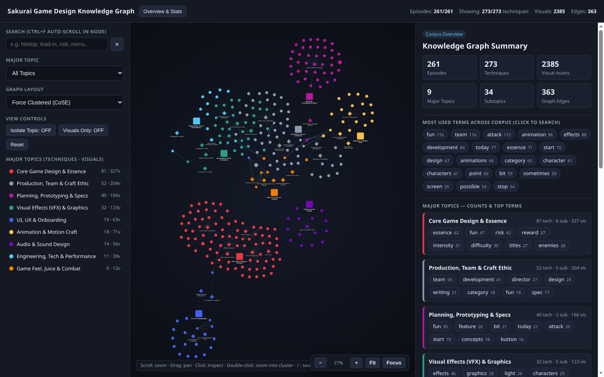
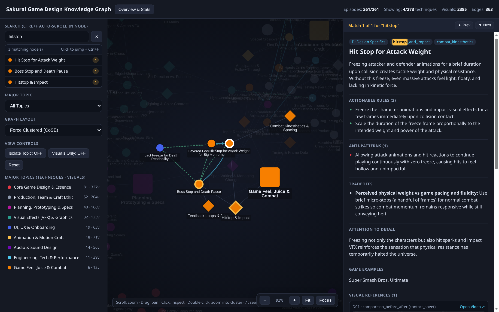
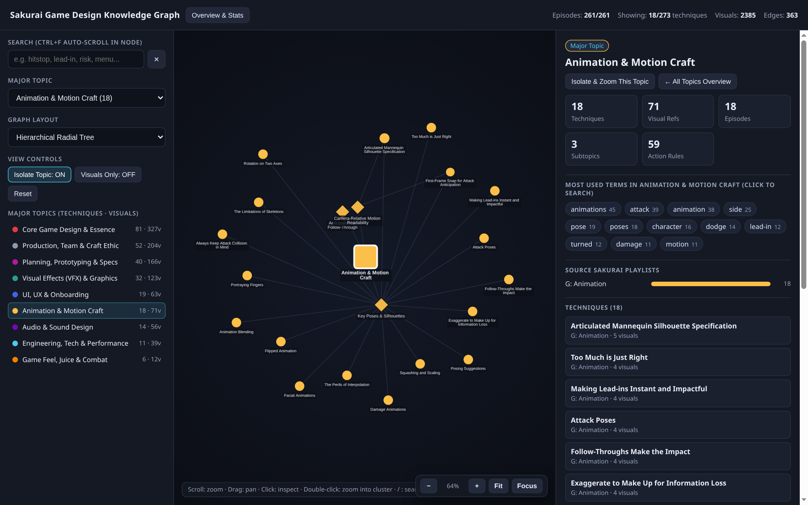
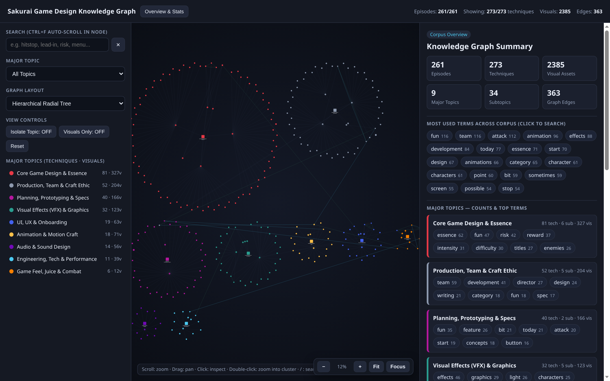

# Sakurai Game Design Knowledge Graph

Turns the full **[Masahiro Sakurai on Creating Games](https://www.youtube.com/@sora_sakurai_en)** YouTube channel into a searchable game design knowledge base. The repo includes clean English transcripts, extracted visual references, techniques grouped under game development topics, and an interactive graph viewer for browsing all of it.



## What it is

Sakurai (director of *Kirby* and *Super Smash Bros.*) published **261 short lessons** on game development, covering game essence, animation, effects, UI, planning, team management, and more. This project:

1. **Extracts the official English text** (the 8-4 Ltd. localization burned into the video frames) using GPU OCR.
2. **Captures his visual explanations**, such as frame-by-frame attack breakdowns, hitstop comparisons, and UI callouts, as compact timestamped contact sheets.
3. **Breaks every episode into atomic techniques**: actionable rules, anti-patterns, tradeoffs, game examples, and citations with YouTube timestamps.
4. **Groups them into a 2-level taxonomy** (11 major topics → 62 subtopics) and links related techniques.
5. **Serves everything in a static, zero-backend graph viewer** with full-text search.

| Corpus | Count |
| :--- | ---: |
| Unique episodes processed | **261** (19.2 hrs; 39 compilation duplicates excluded) |
| Canonical techniques | **273** |
| Visual assets extracted | **2,385** (1,057 linked into the graph) |
| Major topics / subtopics in use | **9 / 34** |
| Graph edges | **363** |

## Why

- **The knowledge is dense but linear.** The insights are spread across hundreds of 3–8 minute videos, so finding "everything Sakurai said about hitstop" means rewatching hours of footage.
- **The visuals matter.** Many lessons depend on side-by-side comparisons and animation timing that plain transcripts lose. The pipeline keeps them, indexed by timestamp.
- **YouTube's auto-captions are not good enough.** They are machine-translated from Japanese audio. The official English subtitles exist only as pixels in the video, so OCR recovers the professional localization.
- **It is a foundation for AI agent skills.** Structured techniques with rules, anti-patterns, and citations can later be distilled into `SKILL.md` files that help coding agents apply these principles to specific game dev tasks.

## Viewer features

| Search with Ctrl+F-style jump-to-match | Isolated topic in radial tree |
| :---: | :---: |
|  |  |

- **Four layouts:** force-clustered, a sunburst-style radial tree, a top-down tree, and concentric rings. **Isolate Topic** re-lays out a single topic full-screen.
- **Search that jumps to the match.** Matching nodes are highlighted and listed with hit counts. Opening a node highlights every occurrence, scrolls to the first one, and shows a sticky `Match 1 of N` bar (`Enter` / `Shift+Enter` to cycle).
- **Analytics:** global KPIs, per-topic counts, **most used terms per major topic** (click a term to search it), Sakurai playlist distribution, and most-cited games.
- **Technique inspector:** rules, anti-patterns, tradeoffs, attention-to-detail notes, inline contact sheets (click for a lightbox), and links to the exact YouTube moment.
- **Navigation:** floating zoom HUD, tuned wheel zoom, double-click to focus a cluster, and the keyboard shortcuts `/` (search), `+` `-` `0` (zoom/fit), and `Esc`.



## Quick start (view only)

The repo ships with the generated graph and referenced visuals, so viewing needs only Python.

```bash
git clone https://github.com/MkHunter/game-design-toolkit.git
cd game-design-toolkit
python3 -m http.server 8765
# open http://localhost:8765/viewer/
```

## Installation (full pipeline)

**Requirements**

- Python ≥ 3.11 with [`uv`](https://docs.astral.sh/uv/)
- `ffmpeg`, [`yt-dlp`](https://github.com/yt-dlp/yt-dlp), and Node.js (used by yt-dlp's JS challenge solver)
- Optional but recommended: an NVIDIA GPU. OCR runs on `onnxruntime-gpu` with pip-installed CUDA 12/cuDNN 9 wheels, and video decode uses NVDEC. This works under WSL2 with no system CUDA toolkit.
- Optional: a [Gemini API key](https://aistudio.google.com/api-keys) for LLM transcript polish, visual analysis, and technique extraction. Without one, the pipeline falls back to local deterministic/heuristic mode at $0.

```bash
uv sync --extra dev          # add --extra gpu for faster-whisper Japanese dual-track checks
export GEMINI_API_KEY=...    # optional
```

## Usage

```bash
# Phase 0: catalog the channel (261 unique episodes → data/catalog/manifest.jsonl)
uv run python scripts/00_discover_catalog.py

# 10-episode stratified pilot, end to end
uv run python scripts/run_pipeline.py --pilot --skip-catalog

# Full corpus (resumable: cached outputs are skipped, heuristic outputs auto-upgrade when a key is set)
uv run python scripts/run_pipeline.py --skip-catalog

# Subsets / offline
uv run python scripts/run_pipeline.py --category G --skip-catalog
uv run python scripts/run_pipeline.py --episodes A01,G03 --offline --skip-catalog
```

| Stage | Script | What it does | Runs on |
| :--- | :--- | :--- | :--- |
| 0 | `00_discover_catalog.py` | Playlist → episode code mapping, excludes compilations | network |
| 1A | `01_download_media.py` | 720p MP4 + auto-captions, client fallbacks, cookie support | network |
| 1B | `02_extract_hardsubs.py` | Bottom-ROI change detection + RapidOCR on official EN subs | **GPU** (CUDA + NVDEC) |
| 1C | `03_clean_transcripts.py` | Timestamped Markdown/JSON transcripts | Gemini Flash-Lite / local |
| 2A | `04_extract_visuals.py` | Shot detection, talking-head filter, pHash dedup, 3×2 contact sheets | CPU |
| 2B | `05_analyze_visuals.py` | Structured visual annotations + Mermaid/ASCII diagrams | Gemini Flash-Lite / local |
| 3A | `06_extract_knowledge.py` | Techniques, rules, tradeoffs, citations, relations | Gemini 3.8 Flash / local |
| 3B | `07_build_graph.py` | Cross-episode dedup, typed edges → `knowledge/graph.json` | local |
| 4 | `08_build_index.py` | SQLite FTS5 index + Obsidian vault | local |

**Query from the CLI** (handy for feeding agent context):

```bash
uv run python scripts/query.py search "lead-in"
uv run python scripts/query.py neighbors tech_hit_stop_for_attack_weight
uv run python scripts/query.py skill-audit     # rank subtopic clusters for SKILL.md authoring
uv run python scripts/verify_dataset.py        # integrity checks
```

**Model and cost controls.** Defaults use a hybrid setup: `gemini-flash-lite-latest` with minimal thinking for stages 03 and 05, and `gemini-3.8-flash` with low thinking for stage 06. The estimated cost for the full corpus is about **$4**. Live token and dollar spend is printed per phase. Override with `SAKURAI_CLEAN_MODEL`, `SAKURAI_VISION_MODEL`, `SAKURAI_KNOWLEDGE_MODEL`, or `--model` / `--thinking-level`.

## Repository layout

```text
viewer/index.html          Static Cytoscape.js graph explorer
knowledge/graph.json       Generated graph bundle (nodes, edges, taxonomy, visuals)
knowledge/taxonomy.yaml    Controlled vocabulary: 11 major topics → 62 subtopics
data/catalog/              Episode manifest (codes, titles, durations, URLs)
data/media/<video_id>/     WebP keyframes/contact sheets (only graph-referenced files are tracked)
scripts/                   Pipeline stages 00–08, query CLI, verifier, orchestrator
docs/screenshots/          README images
PLAN.md                    Full design document and budget analysis
```

Transcripts, raw videos, OCR dumps, the SQLite index, and the Obsidian vault are regenerable and gitignored. After rebuilding the graph, run `uv run python scripts/publish_media.py` to track the newly referenced visuals.

## Current data status

All 261 episodes have OCR transcripts and visuals. **10 pilot episodes** went through full Gemini extraction. The remaining **251 were processed in offline heuristic mode**, which yields one technique per episode, a default subtopic per playlist, and cue-based visual tags. To upgrade them (about $4):

```bash
export GEMINI_API_KEY=...
uv run python scripts/run_pipeline.py --skip-catalog
```

## Attribution & disclaimer

All lesson content, footage, and frames belong to **Masahiro Sakurai / Sora Ltd.** Nintendo-related material appears in the source videos with Nintendo's permission. This is an unofficial, non-commercial study and indexing project. Every technique and visual links back to the original video timestamp, so please watch and support the [official channel](https://www.youtube.com/@sora_sakurai_en). If you are a rights holder and want material removed, open an issue.
